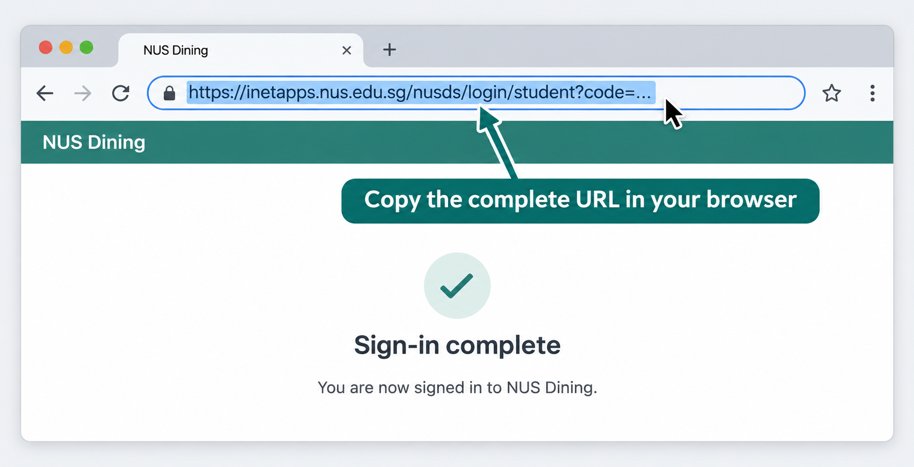

# RC4 Dashboard Admin — Quick Guide

## Sign in

1. Open the dashboard’s `/admin` page.
2. Enter your approved NUS email address.
3. Select **Continue to admin page**.

This is a prototype login and does not verify that you own the entered address. Only emails listed by the project team can continue.

## Update RC4 Highlights

1. Open **RC4 Highlights** and select one of the three cards.
2. Edit its label, headline, description, and footer note.
3. Repeat for any other cards that need updating.
4. Select **Publish all highlights** once.
5. Select **View dashboard** and confirm the update.

## Restore the Dining connection

1. Open **Dining connection** and select **Verify connection**.
2. If it fails, select **Disconnect**, then **Sign in with NUS**.
3. After NUS finishes, copy the complete URL in your browser’s address bar.
4. Paste it into the admin page and select **Connect dining menu**.

Always start a fresh login. Old callback URLs cannot be reused. Select **Sign out** when you are finished.
